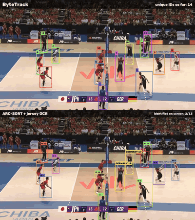
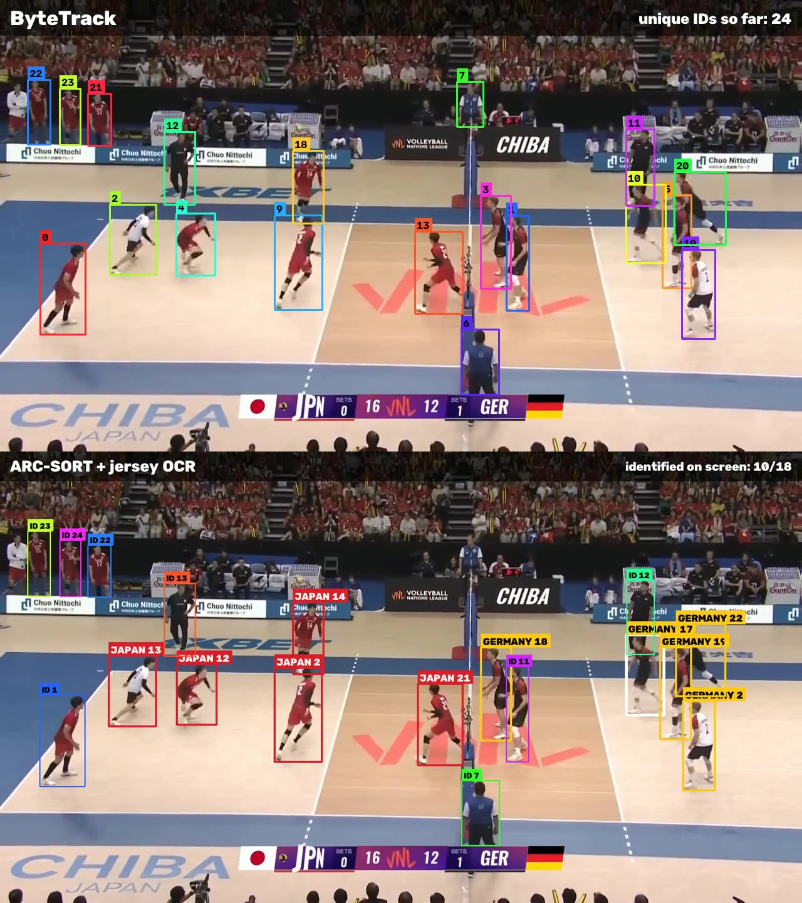
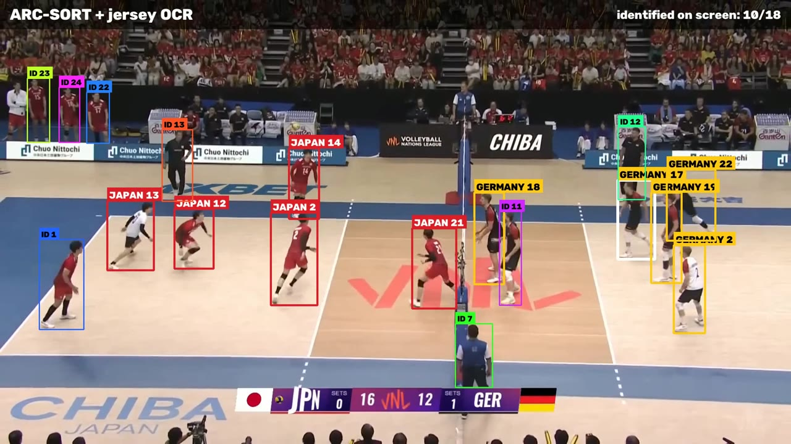

# ARC-SORT + jersey OCR for volleyball

Track every player through a rally, then read their shirt numbers, so the generic `ID 17`
becomes `GERMANY 17` or `JAPAN 14`.



The pipeline runs a COCO-pretrained detector, the open-source [ARC-SORT](https://github.com/Athlitix/arcsort)
tracker and a pretrained [PARSeq](https://github.com/baudm/parseq) text recognizer. Nothing is trained
or fine-tuned, and every label in the video comes straight out of the pipeline, with no manual correction.

## What it does

1. **Detect.** YOLO11-L finds every person in each frame (720p, `imgsz=1280`, confidence floor 0.05).
2. **Track.** ByteTrack and ARC-SORT run on *the same* detections, so the comparison is fair.
3. **Read numbers.** PARSeq reads four chest/back windows of each ARC-SORT box in the 1080p version of the clip.
4. **Lock a number.** A track gets a number once 3 high-confidence reads (≥ 0.8) agree within 2 s and are
   the majority there. `1` and `7` need 5 reads, because arms and shirt stripes are often misread as those.
5. **Assign the team** from the side of the net the player is on (Japan left, Germany right). Officials in
   blue shirts are skipped.
6. **Follow ID switches.** If a track later shows a different number consistently, its label changes,
   and only one player per team can hold a number at a time.



Close-up of the jersey labels (1080p output):



## Results on the demo rally

24 s rally from Germany vs Japan, VNL 2025 (610 frames, 25 FPS):

| | ByteTrack | ARC-SORT |
|---|---|---|
| Unique track IDs | 30 | 30 |
| Tracks shorter than 1 s | 1 | 1 |
| Players identified by number (mean per frame) | – | 8 of ~14 people on screen |

On this one clip, the track counts are the same. The difference is what you can do with the
tracks: the jersey reads turn tracks into named players, and they correct the ARC-SORT ID switch
between German #8 and #17 at about 12 s.

ARC-SORT ran **motion-only** here (no ReID weights, no offline tracklet merge). See the
[ARC-SORT README](https://github.com/Athlitix/arcsort) for its full configuration and benchmark numbers.

## Limits

- Numbers that are blurry or turned away from the camera lock late (Japan #4 only at about 22 s), or never.
- A blurry substitute in the warm-up area is misread once (10, then 18).
- The team is assigned from the side of the net. The net position is tracked from camera motion and
  corrected with 5 anchor points read off the frames by eye (`--net-anchors`), so a new clip needs new anchors.
- Thresholds were tuned on this rally. Expect to retune them for other footage.

**Next step:** use lineup priors. Restricting reads to each team's roster, and to the 6 + libero on court,
would remove impossible numbers and duplicate labels. It won't settle confusions between two numbers
that are both on the roster (e.g. 8 vs 18).

## Setup

Tested on an NVIDIA Jetson (JetPack 6, aarch64, Python 3.10) running on **CPU**. Any Linux or macOS
machine with Python 3.10+ should work, and a CUDA PyTorch build makes detection much faster.

```bash
python3 -m venv venv
venv/bin/pip install torch torchvision --index-url https://download.pytorch.org/whl/cpu   # or a CUDA build
venv/bin/pip install -r requirements.txt
ln -sf "$(venv/bin/python -c 'import imageio_ffmpeg; print(imageio_ffmpeg.get_ffmpeg_exe())')" venv/bin/ffmpeg
```

If `python3 -m venv` complains that `ensurepip` is missing (Ubuntu without `python3-venv`), use
`python3 -m venv --without-pip venv`, download https://bootstrap.pypa.io/get-pip.py and run
`venv/bin/python get-pip.py`.

The YOLO and PARSeq weights download automatically on first run.

## Get the clip

The broadcast video isn't included in this repo. Download it from Volleyball World's YouTube channel
and cut the rally (42:58, 24.4 s):

```bash
mkdir -p input
URL="https://www.youtube.com/watch?v=4krltF0OwMA"     # Germany vs Japan, VNL 2025, Week 3
venv/bin/yt-dlp -f 136 -o input/full_720.mp4  "$URL"   # 720p, for detection + tracking
venv/bin/yt-dlp -f 137 -o input/full_1080.mp4 "$URL"   # 1080p, for jersey OCR
venv/bin/ffmpeg -ss 42:58.0 -i input/full_720.mp4  -t 24.4 -an -c:v libx264 -crf 16 input/rally_4258.mp4
venv/bin/ffmpeg -ss 42:58.0 -i input/full_1080.mp4 -t 24.4 -an -c:v libx264 -crf 14 input/rally_4258_1080.mp4
```

## Run

```bash
# 1. detection + ByteTrack + ARC-SORT, renders bytetrack.mp4, arcsort.mp4, side_by_side.mp4, stacked.mp4
venv/bin/python compare.py input/rally_4258.mp4 --out output/rally_4258

# 2. jersey OCR on the ARC-SORT tracks, renders arcsort_jersey_ids.mp4 and jersey_ids.json
venv/bin/python number_video.py --video input/rally_4258.mp4 --video-hr input/rally_4258_1080.mp4 \
    --out output/rally_4258

# 3. ByteTrack on top, ARC-SORT + jersey OCR below (1280x1440, phone-friendly)
venv/bin/python stack.py --out output/rally_4258
```

Every stage caches its output (`detections.npz`, `tracks_*.npz`, `net_x.npy`, `ocr_reads.npy`), so you
can retune thresholds (`--min-conf`, `--min-votes`, `--window`) and re-render without running detection or OCR again.

On a Jetson CPU, detection takes about 1.5 s per frame and OCR about 1.5 s per frame (OCR runs on every 2nd frame).
With a GPU, both take a fraction of that.

## Files

| File | What it does |
|---|---|
| `compare.py` | YOLO detection, ByteTrack vs ARC-SORT on identical detections, comparison videos |
| `jersey_ocr.py` | PARSeq wrapper: torso crops → jersey number + confidence |
| `number_video.py` | Net tracking, OCR on every track, number locking, labelled 1080p video |
| `stack.py` | Stacks the ByteTrack and jersey-OCR videos vertically |

## Credits and licenses

- [ARC-SORT](https://github.com/Athlitix/arcsort) by Girish Kumar Adari / Athlitix (Apache-2.0)
- [ByteTrack implementation](https://github.com/roboflow/trackers) from Roboflow `trackers` (Apache-2.0)
- [PARSeq](https://github.com/baudm/parseq) by Darwin Bautista and Rowel Atienza (Apache-2.0)
- [Ultralytics YOLO11](https://github.com/ultralytics/ultralytics) (AGPL-3.0, so check its terms before any commercial use)
- Footage: Volleyball World. The video isn't redistributed here, and the images in `docs/` are
  stills from the broadcast, used to illustrate the results.

The code in this repository is released under the MIT License (see `LICENSE`).
